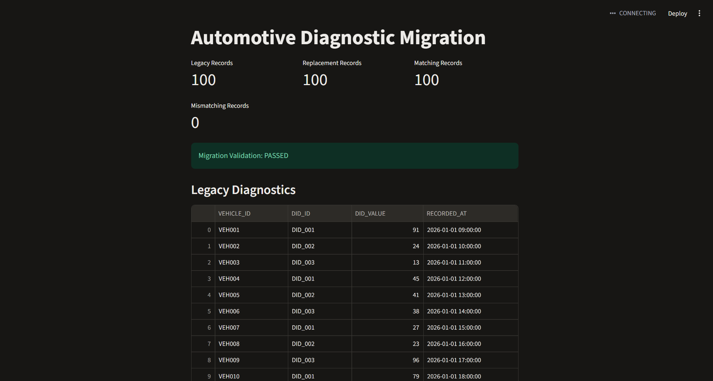

# Automotive Diagnostic Data Migration

A personal project using Python, Snowflake and dbt to recreate a real-world automotive data migration problem.

## Overview

This project is based on a data migration requirement I came across while working in automotive engineering.

The aim was to replace diagnostic data extracts from an older system with equivalent data from a newer platform, without affecting the reports that already relied on them.

I wanted to recreate a simplified version of this problem using my own synthetic data, while developing my skills in Snowflake, SQL and dbt.

## The Problem

When moving from an older data platform to a newer one, the way data is stored and structured can change.

For example, a vehicle diagnostic parameter might have one column name in the legacy system and a completely different name in the replacement platform.

Even if the underlying data is the same, existing reports may stop working if they're expecting the original column names.

The objective of this project was therefore fairly simple: **retrieve diagnostic data from the replacement platform and make it available in the same format as the original extract.**

## What I Built

I used Python to generate two synthetic diagnostic datasets containing 100 identical records with different column structures.

I automated the ingestion process using Python to upload the CSV files into Snowflake, then used dbt to transform the replacement data into the original reporting format.

Finally, I implemented seven automated dbt tests to validate data quality and confirm that both datasets match.

## Technologies Used

- Python - Synthetic data generation and automated Snowflake ingestion
- Snowflake - Stored and queried the diagnostic data
- SQL - Transformed and compared the datasets
- dbt - Built the transformation model and automated tests
- Streamlit - Visualised the datasets and migration validation results
- Git / GitHub - Version control and project documentation
- GitHub Actions - Automated Python syntax and data generation checks

## Data Transformation

The two datasets use different column names:

| Legacy System | Replacement Platform |

| VEHICLE_ID | ASSET_REF |
| DID_ID | DIAGNOSTIC_CODE |
| DID_VALUE | MEASUREMENT |
| RECORDED_AT | EVENT_TIMESTAMP |

Using dbt, I created a model that retrieves the replacement data and renames the columns to match the legacy extract.

```sql
SELECT
    ASSET_REF AS VEHICLE_ID,
    DIAGNOSTIC_CODE AS DID_ID,
    MEASUREMENT AS DID_VALUE,
    EVENT_TIMESTAMP AS RECORDED_AT
FROM {{ source('raw', 'REPLACEMENT_DIAGNOSTICS') }}
```

The model creates a view in Snowflake, which can then be queried using the original column names.
This means a report expecting the legacy structure could use the replacement data without needing changes to its column references.

## Data Validation

I also wanted to make sure the replacement extract contained the correct data, rather than just having the right column names.

I added seven dbt tests to check:
- Vehicle IDs, diagnostic IDs and timestamps aren't missing
- Each vehicle, diagnostic ID and timestamp combination is unique
- All legacy records are present in the replacement extract
- The replacement extract doesn't contain unexpected records
- Both datasets contain the same number of records

For the migration checks, I used SQL MINUS queries to compare the datasets in both directions.

All seven tests passed using the generated dataset of 100 records.

I also tested the validation process by deliberately changing a diagnostic value in the replacement dataset. Both migration comparison tests detected the mismatch, while the remaining five tests passed. After restoring the original data, all seven tests passed again.

## What I've Learned
- This project has helped me put what I've learned through Snowflake and dbt training into practice.
- In particular, I've gained more experience with creating Snowflake tables and views, defining dbt sources and models, and using automated tests to validate data.
- It's also helped me understand how important data validation is when replacing an existing data source. Getting the columns right is only part of the problem; the data itself needs to be consistent too.

## Streamlit Dashboard

- I built a Streamlit dashboard to visualise the migration results using data retrieved directly from Snowflake.
- The dashboard displays the legacy and transformed replacement datasets, along with the number of matching and mismatching records.
- It also displays a validation status to indicate whether the two datasets match.
- I tested this by deliberately changing a diagnostic value in Snowflake. The dashboard detected the mismatch and displayed a failed validation status. After restoring the original data, validation passed again.





## Running the Pipeline

Install the required Python packages:

```bash
python -m pip install -r requirements.txt
```

The full pipeline can be executed from the project root using:

```bash
python run_pipeline.py
```

This will:
1. Generate the synthetic diagnostic datasets.
2. Upload both datasets into Snowflake.
3. Build the dbt model and run all seven validation tests.

The pipeline stops if any step fails.

To launch the Streamlit dashboard:

```bash
python -m streamlit run dashboard/app.py
```

A local `.env` file containing Snowflake credentials, a configured dbt profile and the required Snowflake database objects are needed.

## Potential Improvements
- Extend GitHub Actions to run dbt validation tests.
- Improve the migration comparison to handle duplicate records.
- Explore incremental data loading instead of replacing the full dataset each time.

## Note
- All diagnostic data used in this project is fictional and generated specifically for this repository. No internal company data, code or confidential information has been used.

